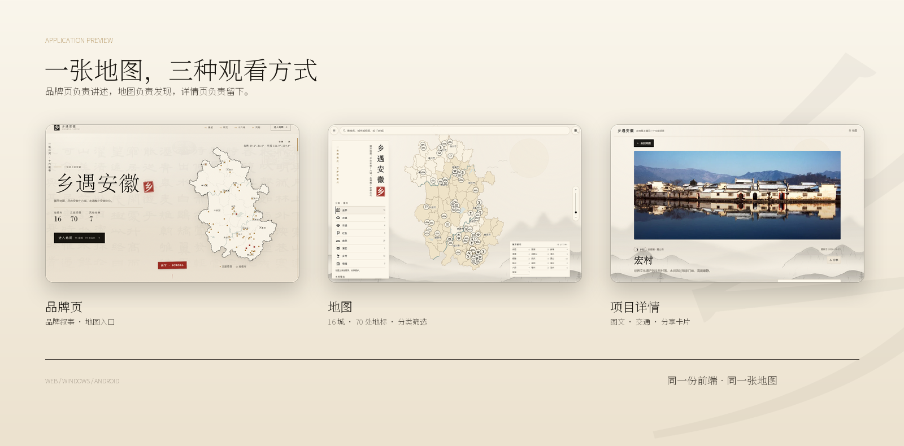
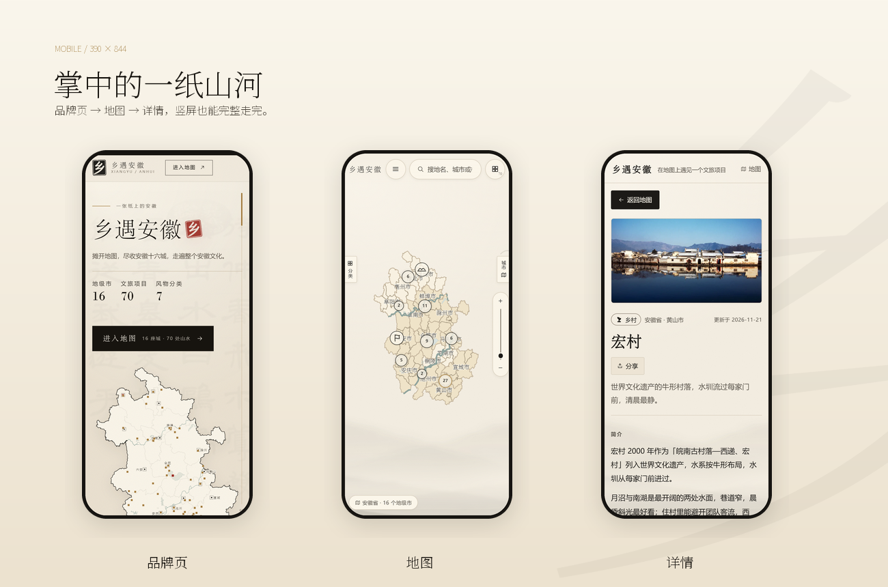
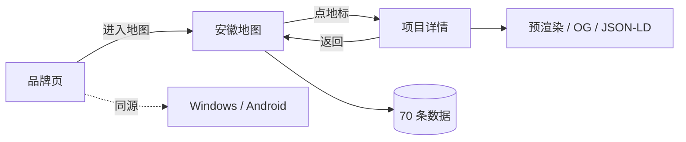

<div align="center">
  
</div>

<h1 align="center">乡遇安徽</h1>

<p align="center">
  <strong>一张纸上的安徽，十六城、七十处山水。</strong><br />
  在地图上遇见值得专程一去的文旅项目。
</p>

<p align="center">
  <a href="https://hldwsd.github.io/xiangyu-map/"></a>
  <a href="https://github.com/Hldwsd/xiangyu-map/releases/tag/v0.1.0"></a>
  
  
  
  
</p>

---

> 「一生痴绝处，无梦到徽州。」
>
> 安徽的美，不在一个点上。它在皖南的粉墙黛瓦，在淮河的舟楫，在一条窄巷、一方砚台、一座山。
> **乡遇安徽** 把这些散落的坐标，收进同一张纸、同一张地图。

## 一眼安徽

- **16 座城**：按安徽省 16 个地级市分区，省界、区县界、湖泊与长江/淮河水道同图呈现；
- **70 处山水**：古镇、非遗、红色、自然、演艺、乡村、场馆，7 类地标，逐条可核验；
- **一张纸**：纸本墨线、宋体标题、朱砂落款；地图不是仪表盘，是一张可以摊开的纸；
- **三端同源**：Web、Windows、Android 共用一份前端与同一张地图，启动都先到品牌页。

## 预览



<div align="center">
  
</div>

## 它能做什么

| 发现                                 | 读懂                                 | 带走                            |
| ------------------------------------ | ------------------------------------ | ------------------------------- |
| 分类筛选、关键词搜索、城市索引       | 项目详情：图文、最佳季节、交通、预约 | 分享卡片、复制链接、保存图片    |
| 地标聚合与软碰撞，缩放不重叠         | 同城推荐、高德精确 POI 短链          | 70 个详情页预渲染，可直接被收录 |
| 品牌页滚动叙事，回答「这张图是什么」 | 来源、更新时间与数据校验             | Windows / Android 安装包        |

## 三端

| 平台    | 入口                                                                                                                    | 说明                                  |
| ------- | ----------------------------------------------------------------------------------------------------------------------- | ------------------------------------- |
| Web     | [hldwsd.github.io/xiangyu-map](https://hldwsd.github.io/xiangyu-map/)                                                   | 根路径品牌页，`/map/` 是地图          |
| Windows | [NSIS 安装包](https://github.com/Hldwsd/xiangyu-map/releases/download/v0.1.0/xiangyu-anhui_0.1.0_windows_x64_setup.exe) | 默认装到 `%LOCALAPPDATA%\xiangyu_map` |
| Android | [arm64 APK](https://github.com/Hldwsd/xiangyu-map/releases/download/v0.1.0/xiangyu-anhui_0.1.0_android_arm64.apk)       | 比赛演示证书签名                      |

两个 App 都从品牌页启动，点「进入地图」才进地图；与网页入口一致。

## 设计

品牌页不是封面，而是正文的开始：省界在滚动中显影，十六座城的名字逐个落纸，六处项目横向展开，最后以朱砂落款收束。

- 米白纸、墨线、宋体、金色点睛；
- 分类靠**形状**区分，不靠颜色堆叠；
- 背景为邓石如《少学琴书册》墨迹（清代，公有领域）；
- 地图支持区县界、湖泊、河道与省界光晕，缩放/拖动保持地标相对位置。

## 技术



| 层          | 选型                                       |
| ----------- | ------------------------------------------ |
| 框架        | Vue 3 + TypeScript + Vite                  |
| 地图        | Apache ECharts 6（geo + scatter + canvas） |
| 状态 / 路由 | Pinia / Vue Router                         |
| 品牌页      | GSAP 3 + ScrollTrigger                     |
| 多端        | Tauri 2（Windows NSIS + Android APK）      |
| 质量        | Vitest + Playwright + ESLint + Prettier    |

## 开始

```bash
pnpm install
pnpm dev          # http://localhost:5173
```

```bash
pnpm build        # 类型检查 + 生产构建
pnpm test:unit    # 154 个单测
pnpm test:e2e     # Playwright 桌面 + 移动
pnpm desktop:build
pnpm android:build
```

## 质量

| 项                           | 值                                        |
| ---------------------------- | ----------------------------------------- |
| 单测                         | 154 passed                                |
| 覆盖率（核心逻辑，阈值 70%） | 语句 91.84% / 分支 85.60%                 |
| E2E                          | 18 passed / 4 skipped                     |
| 首屏预算                     | 入口 JS ≈ 267 / 300 KB，CSS 6.75 / 60 KB  |
| Lighthouse（生产站）         | 桌面 93 / 移动 77，a11y 100、SEO 100      |
| Android 真机                 | 品牌页滚动 p90 20ms；地图平移 p90 约 14ms |

## 已知问题

- **审图号与底图授权**：当前底图仍是开发期示意数据，公开上线前须替换为经审核数据并标注审图号；
- **图片版权**：封面/画廊/分享图来自公开资料，商用前需逐张确认或替换（ADR 0011）；
- **内容深度**：20 条 practical 缺开放时间/门票，58 条没有画廊，演艺类仅 1 条；
- **签名**：Windows 未签名，Android 为比赛演示证书，仅适合比赛/内部分发。

## 文档

- [项目规划与里程碑](docs/PROJECT_PLAN.md)
- [交接文档](docs/HANDOFF.md)
- [架构决策记录](docs/adr/README.md)
- [发布说明 v0.1.0](docs/release-notes/v0.1.0.md)

## License

代码以 MIT 发布；地图数据、图片与引用文字版权归原作者，使用前请阅读 [public/maps/README.md](public/maps/README.md) 与 [ADR 0011](docs/adr/0011-cover-source-baike.md)。
